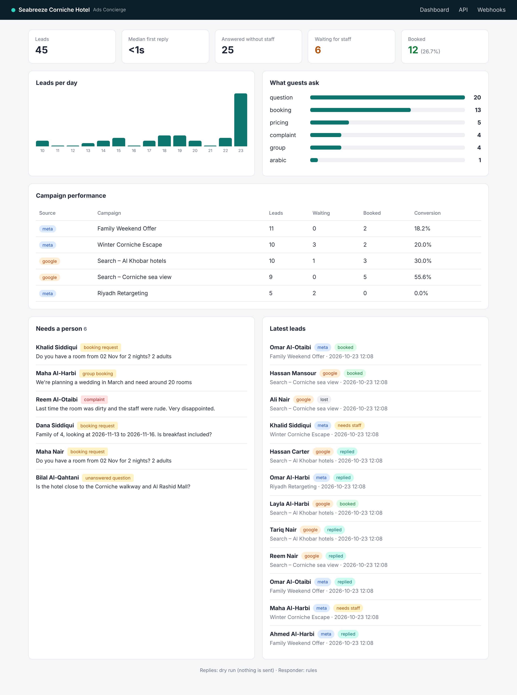
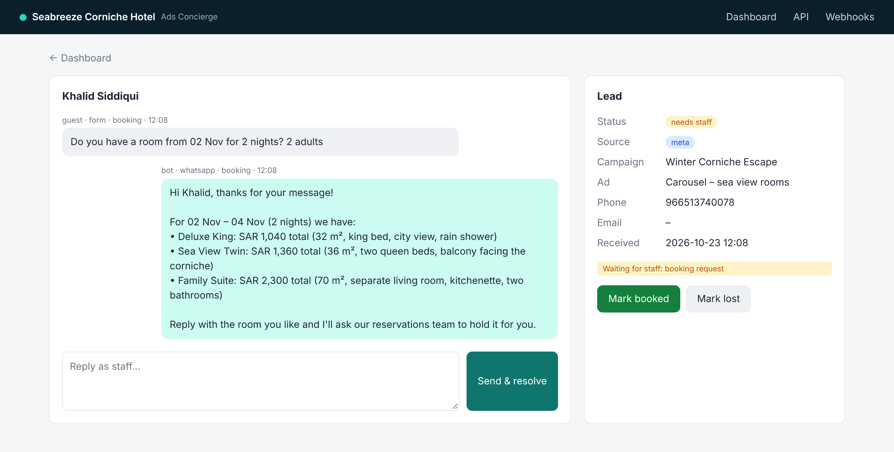

# Hotel Ads Concierge

Replies to hotel leads from Facebook/Instagram and Google ads within seconds, on WhatsApp or email, and hands the conversation to a person when it needs one.



## Why I built this

Hotels running lead ads usually have the same problem. The forms fill up at night and on weekends, and by the time reservations calls back the next morning, the guest has booked somewhere else. Most of the questions are the same ten things: price for these dates, is breakfast included, parking, airport pickup, pool hours.

This app sits between the ad platforms and the reservations team:

```
Meta Lead Ads ─┐                         ┌─ answered automatically ──► WhatsApp / email
Google Ads    ─┼─► webhook ─► responder ─┤
WhatsApp msg  ─┘   (dedupe)   (rules/LLM)└─ needs a person ─► staff queue on dashboard
```

- **Lead intake** from Meta Lead Ads (signature-verified webhook plus a Graph API lookup), Google Ads lead forms (`google_key` check) and inbound WhatsApp messages. Retried webhooks are ignored, so a guest never gets two replies.
- **Instant reply** in the guest's language. It can read dates in the ways people actually type them ("12-14 Nov", "12/11 - 15/11", "Nov 3rd for three nights"), works out the total per room type with weekday and weekend rates, and skips sold-out rooms and rooms too small for the group.
- **Handoff rules.** Complaints, group and wedding enquiries, booking requests and anything the bot can't answer go to a staff queue. While a person owns the conversation, the bot stays quiet.
- **Dashboard** showing leads per day, what guests ask about, conversion per campaign and the staff queue. Staff can reply and mark leads booked or lost from the conversation view.



## AI mode

The default responder uses rules and templates with no external calls. Set `LLM_PROVIDER=openai` or `anthropic` and the model writes the reply instead. It only gets facts the app has already worked out: matched policies, room list and the computed quote.

The output is checked before anything is sent. If the reply contains a price that isn't in the hotel's data or in the quote, it's discarded and the rules reply goes out instead (`Responder._prices_ok`). Complaints never go through the model. If the API times out or returns bad JSON, the guest still gets the rules reply.

## Running it

```bash
python -m venv .venv && source .venv/bin/activate
pip install -r requirements.txt
uvicorn app.main:app --reload            # http://127.0.0.1:8000

# in another terminal – send 40 fake leads through the real webhook endpoints
python scripts/simulate_leads.py
```

Or with Docker:

```bash
docker build -t hotel-concierge .
docker run -p 8000:8000 --env-file .env -v concierge-data:/data hotel-concierge
```

Tests: `pytest -q` (28 tests covering date parsing, pricing, intent rules, the LLM guardrail, signatures, dedupe and the staff handoff).

## Connecting the real platforms

| Platform | What to set up | Env vars |
|---|---|---|
| Meta Lead Ads | App with `leadgen` webhook on your page → `https://<host>/webhooks/meta` | `META_VERIFY_TOKEN`, `META_APP_SECRET`, `META_PAGE_TOKEN` |
| Google Ads | Lead form → Webhook integration → `https://<host>/webhooks/google` | `GOOGLE_LEAD_KEY` |
| WhatsApp Cloud API | Webhook `messages` field → `https://<host>/webhooks/whatsapp` | `WHATSAPP_TOKEN`, `WHATSAPP_PHONE_ID` |
| Email fallback | Any SMTP server | `SMTP_*` |

`DRY_RUN=1` is the default, so replies are written to the `outbox` table and nothing is sent until you switch it off.

Note: WhatsApp only allows free-form messages within 24 hours of the guest's last message. For a first contact from an ad form in production, you'd send an approved template message first.

## Adapting it to another hotel

Everything hotel-specific is in [`data/hotel.json`](data/hotel.json): rooms, weekday and weekend rates, which nights count as the weekend, sold-out dates, policies with the keywords that trigger them, and Google campaign names. No code changes are needed.

## Project layout

```
app/
  main.py          FastAPI routes: webhooks, dashboard, JSON API
  service.py       lead lifecycle: store → respond → deliver → handoff
  responder.py     intent rules, reply templates, LLM mode + guardrail
  hotel.py         date/guest parsing, rates, availability
  channels.py      WhatsApp / SMTP delivery, phone normalisation, outbox
  metrics.py       dashboard numbers
  sources/         Meta, Google, WhatsApp payload handling
scripts/simulate_leads.py
tests/
```

## Limitations

- Availability comes from a static sold-out list, not a PMS. The next step would be an adapter for the hotel's channel manager.
- SQLite is fine for one property. For a group of hotels, I'd move to Postgres and add a `property_id` column.
- The demo data (hotel, guests, campaigns) is made up.

---

Built by [Usman Saleem Bhatti](https://www.upwork.com/freelancers/~017ac7683856df4451). Questions or want something similar for your property? Get in touch on Upwork.
